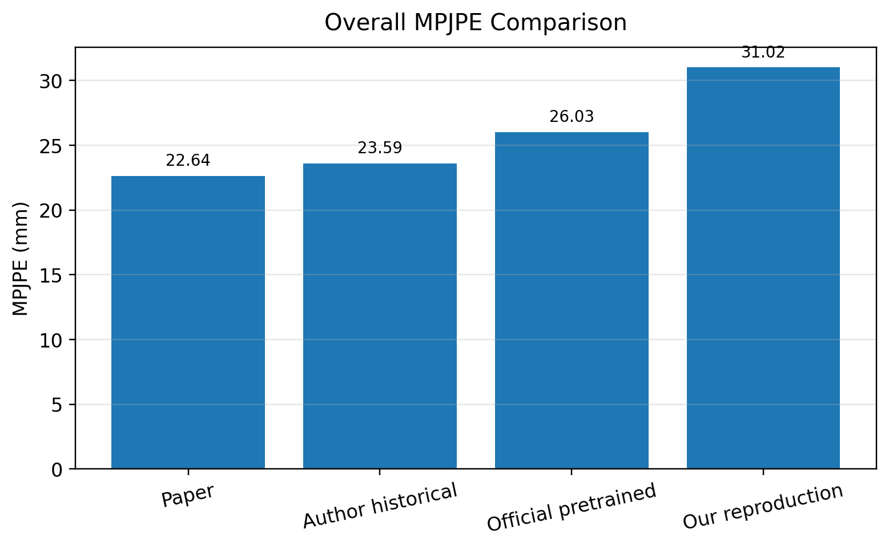
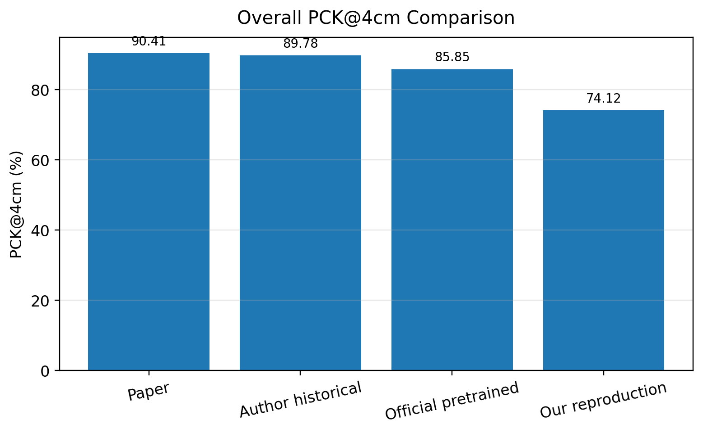
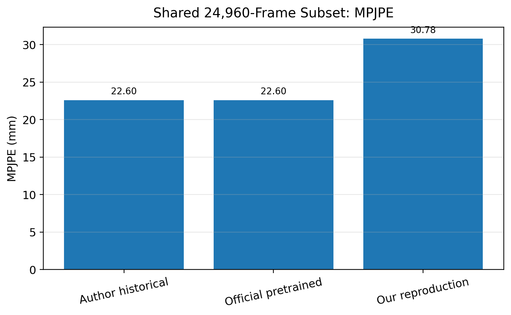
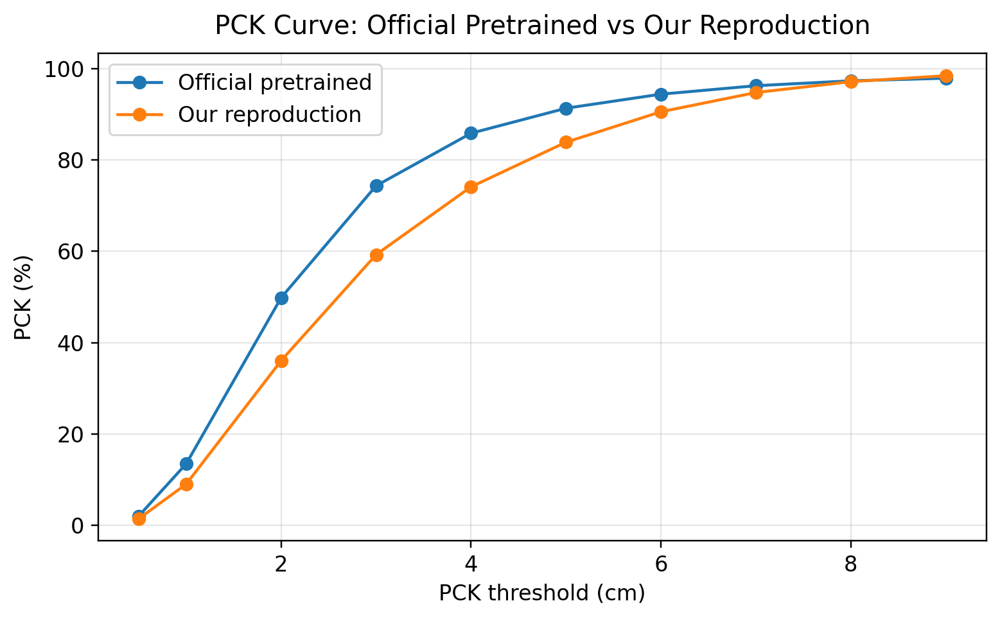
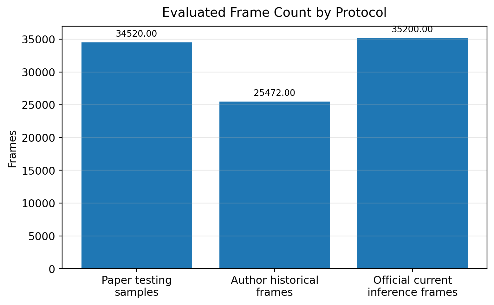
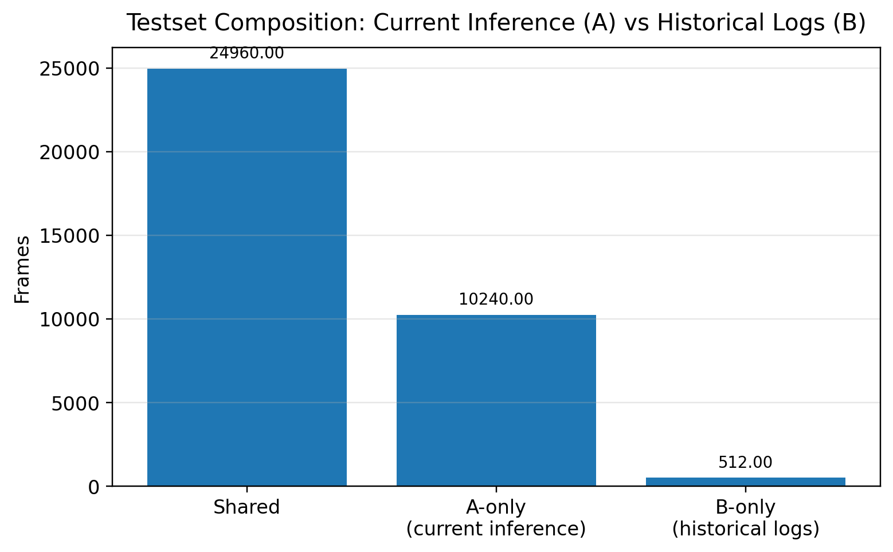
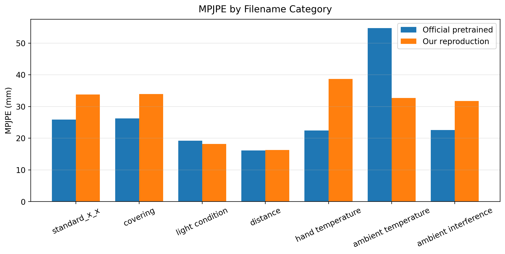

# TAPOR Baseline Reproduction

## Overview

This directory records our Stage-1 reproduction audit of the official [TAPOR](https://github.com/aiot-lab/TAPOR) baseline. Training and independent evaluation used the authors' TAPOR source at commit `09b8e7c`; this repository stores the reproduction wrappers, compatibility patch, trained checkpoint, compact audit outputs, and figures rather than a copy of the full upstream repository or raw data.

## Training Configuration

| Item | Value |
|---|---|
| Model | TAPOR base1 (`-m tapor -mt 1`) |
| Optimizer | Adam |
| Learning rate | 0.0001 |
| Batch size | 48 |
| Epochs | 200 |
| Fragment size / input map | 1 / native 32 x 24 (`-fs 1 -ms 0`) |
| Loss | joint MSE + bone-length loss (`-ls jb`) |
| Best checkpoint | Epoch 194, selected by validation coordinate MAE |
| GPU used for completed run | NVIDIA RTX 4090 |

The completed training command was:

```bash
python traintest.py -m tapor -e 200 -b 48 -fs 1 -ms 0 -t 0 -lr 0.0001 -hm 0 -fo 1 -s 0 -mt 1 -ls jb -tqdm 1
```

The resulting raw PyTorch `state_dict` was saved locally as `weights/tapor_reproduced.pth` (gitignored; not uploaded). SHA-256: `7c87dc5cd1aaa2029ba9511092d7735f70114e573dcf9ba2eca3ddd59735c60f`.

## Evaluation Results

| Model / Source | MPJPE (mm) | PCK@4cm (%) | Evaluated Frames |
|---|---:|---:|---:|
| Paper TAPOR | 22.6360 | 90.4100 | 34,520 reported |
| Author Historical Logs | 23.5936 | 89.7785 | 25,472 |
| Official Pretrained evaluated by us | 26.0315 | 85.8502 | 35,200 |
| Our 200-epoch reproduction | 31.0186 | 74.1246 | 35,200 |

**These results are not all evaluated under an identical test protocol and should not be interpreted as a strictly fair four-model comparison.** The paper value is reported from Figure 12(c); the historical archive and current inference results retain different file sets.

## Testset Protocol Differences

- Current official `inference.py`: 207 files and 35,200 evaluated frames.
- Author historical LogInference record: 102 files and 25,472 evaluated frames.
- Shared set: 100 files and 24,960 frames; every corresponding label array is identical.
- Current-inference-only: 107 files and 10,240 frames.
- Historical-only: 2 files and 512 frames.
- The paper reports 34,520 test samples, but no complete file list capable of recovering that exact protocol was found.

The historical 23.5936 mm versus current official 26.0315 mm difference is mainly explained by test-file selection. The detailed audit does not support deleting frames to force the reported paper count.

## Fair Comparison on Shared Frames

All entries below use the exact common 24,960 labeled frames.

| Model | MPJPE (mm) | PCK@4cm (%) |
|---|---:|---:|
| Official Pretrained | 22.5966 | 90.5266 |
| Author Historical | 22.5966 | 90.5258 |
| Our Reproduction | 30.7832 | 74.1369 |

The public pretrained and historical model outputs are nearly identical on their shared examples. The reproduced model remains substantially worse on the same frames.

## Figures

### Main figures















### Additional figures

| Figure | Link |
|---|---|
| Training loss | [training_loss_curve.png](../../figures/tapor/training_loss_curve.png) |
| Validation MSE | [validation_mse_curve.png](../../figures/tapor/validation_mse_curve.png) |
| Validation MAE | [validation_mae_curve.png](../../figures/tapor/validation_mae_curve.png) |
| Shared-subset PCK@4cm | [shared_subset_pck4cm.png](../../figures/tapor/shared_subset_pck4cm.png) |
| Category frame counts | [testset_category_frame_counts.png](../../figures/tapor/testset_category_frame_counts.png) |
| Category PCK@4cm | [category_pck4cm_official_vs_ours.png](../../figures/tapor/category_pck4cm_official_vs_ours.png) |
| Joint error comparison | [joint_error_comparison.png](../../figures/tapor/joint_error_comparison.png) |
| Per-user-token MPJPE | [per_user_mpjpe.png](../../figures/tapor/per_user_mpjpe.png) |
| Official framewise MPJPE | [framewise_mpjpe_histogram_official.png](../../figures/tapor/framewise_mpjpe_histogram_official.png) |
| Reproduction framewise MPJPE | [framewise_mpjpe_histogram_ours.png](../../figures/tapor/framewise_mpjpe_histogram_ours.png) |
| Per-file MPJPE box plot | [per_file_mpjpe_boxplot.png](../../figures/tapor/per_file_mpjpe_boxplot.png) |

Figure provenance, protocol notes, and recommended README selection are in [GITHUB_FIGURE_SUMMARY.md](GITHUB_FIGURE_SUMMARY.md) and [README_FIGURE_SELECTION.md](README_FIGURE_SELECTION.md).

## Reproduction Gap Analysis

We completed the official 200-epoch / batch-48 training configuration, but our trained checkpoint does not reach the public author checkpoint's performance. The gap persists on the exact shared 24,960-frame subset. There is no evidence that the gap is mainly caused by using too few epochs: the completed run used the official 200-epoch setting and selected the best validation-MAE checkpoint at Epoch 194.

The remaining candidates require controlled follow-up: random-state and deterministic settings, exact training-data version and split, data processing, model/checkpoint configuration, and checkpoint-selection details. We do **not** claim to have reproduced the Figure 12(c) paper accuracy.

## How to Reproduce

### Prerequisites

1. Clone the upstream TAPOR repository at commit `09b8e7c` separately; it is intentionally not vendored here.
2. Obtain the official pose `Trainset/` and `Testset/` pkl files separately. Raw data, author Logs, TensorBoard events, and `result_dict.pkl` files are intentionally excluded from this repository.
3. Create the upstream environment from `environment.yml` (Python 3.8 / PyTorch CUDA environment). The wrapper scripts require the upstream dependencies including PyTorch, torchvision, OpenCV, timm, tqdm, tensorboard, and MANO.

On the Linux GPU host, configure the locations first:

```bash
export TAPOR_ROOT=/workspace/TAPOR
export DATA_ROOT=/root/sj-tmp/tapor_data
export RUNS_ROOT=/root/sj-tmp/tapor_runs
export REPO_ROOT=/path/to/comp9501_project2
cd "$REPO_ROOT"
```

Validate data and host, then apply the minimal compatibility fix. The patch only corrects GPU UUID parsing in upstream `traintest.py:get_gpu_ids`; it does not change the model, loss, data protocol, or metrics.

```bash
scripts/tapor/prepare_tapor_paths.sh
scripts/tapor/check_environment.sh
scripts/tapor/apply_tapor_compat_patch.sh
python scripts/tapor/inspect_dataset.py --tapor-root "$TAPOR_ROOT" --data-root "$DATA_ROOT" --report "$RUNS_ROOT/dataset_inspection.json" --require-complete
```

Run full training in `tmux`:

```bash
tmux new -s tapor-baseline
scripts/tapor/run_train_full.sh
```

Run independent official inference after placing a checkpoint under `$TAPOR_ROOT/weights/`:

```bash
scripts/tapor/run_pretrained_inference.sh tapor.pth
cp weights/tapor_reproduced.pth "$TAPOR_ROOT/weights/tapor_reproduced.pth"
scripts/tapor/evaluate_checkpoint.sh tapor_reproduced.pth
```

To recompute audit metrics or figures, first provide the excluded raw artifacts locally. The arguments below are real script inputs; they cannot run from this Git repository alone because large prediction pkl files and TensorBoard events are not versioned.

```bash
python scripts/tapor/audit_inference_results.py \
  --pretrained /path/to/inference_results/tapor_type1_weights_tapor.pth_2026111695944_result_dict.pkl \
  --retrained /path/to/inference_results/tapor_type1_weights_1_20261116103244_tapor.pth_2026111616649_result_dict.pkl \
  --official-logs /path/to/official_logs \
  --output results/tapor/audit_evidence.json

python scripts/tapor/compare_testsets.py \
  --a-pretrained /path/to/inference_results/tapor_type1_weights_tapor.pth_2026111695944_result_dict.pkl \
  --a-retrained /path/to/inference_results/tapor_type1_weights_1_20261116103244_tapor.pth_2026111616649_result_dict.pkl \
  --b-history /path/to/official_logs/Logs/LogInference/tapor_type1_weights_77_20242421040_tapor.pth_202431124637_result_dict.pkl \
  --logs-root /path/to/official_logs --output-dir results/tapor

python scripts/tapor/generate_figures.py \
  --artifact-root /path/to/full-local-analysis \
  --output-dir figures/tapor \
  --manifest results/tapor/figure_manifest.json
```

## Code Provenance

- `scripts/tapor/*.sh`, `inspect_dataset.py`, `verify_model.py`, and `collect_results.py`: our reproducibility wrappers around unmodified official TAPOR training/inference code.
- `scripts/tapor/patches/tapor-gpu-selection.patch`: compatibility-only correction for the official GPU UUID parsing bug; it is not an algorithmic change.
- `scripts/tapor/audit_inference_results.py`, `compare_testsets.py`, and `generate_figures.py`: our read-only metric, protocol-audit, and visualization tooling.
- The TAPOR architecture, loader, losses, and MPJPE/PCK implementation remain in the separately cloned official source. No complete upstream repository is copied here.
