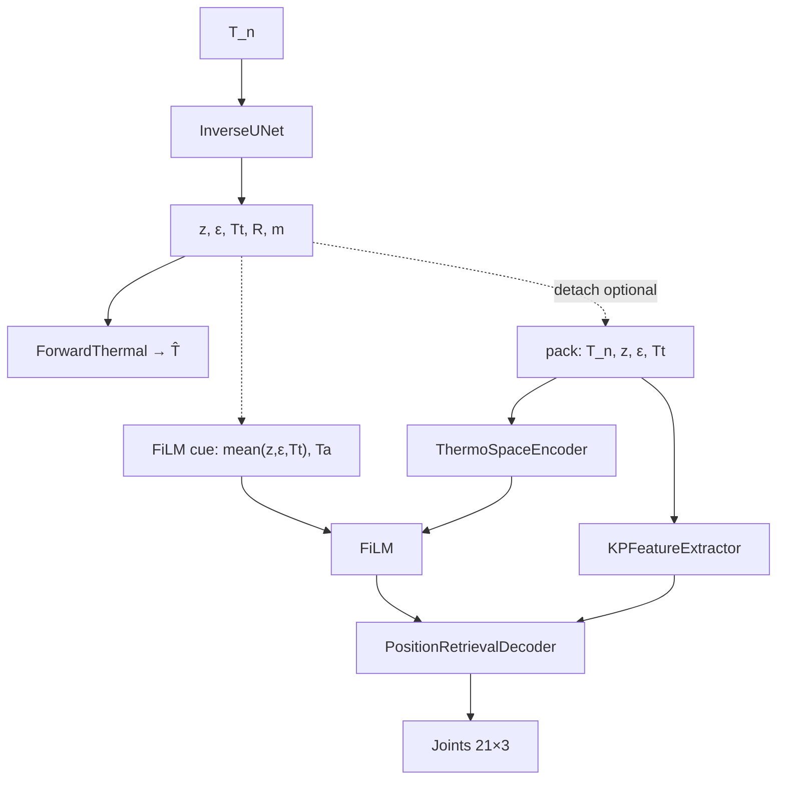
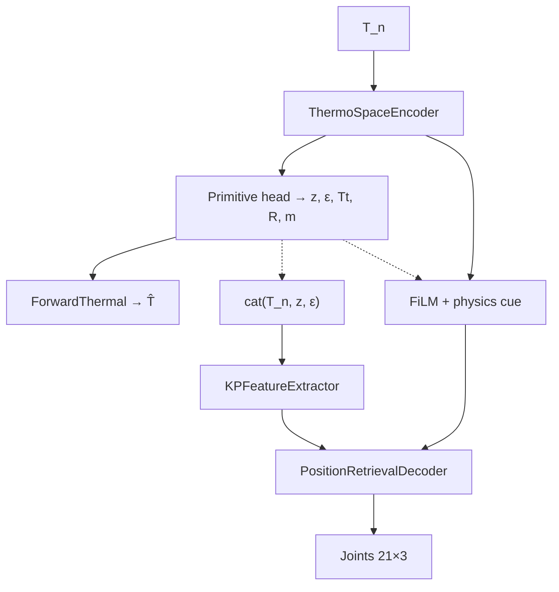
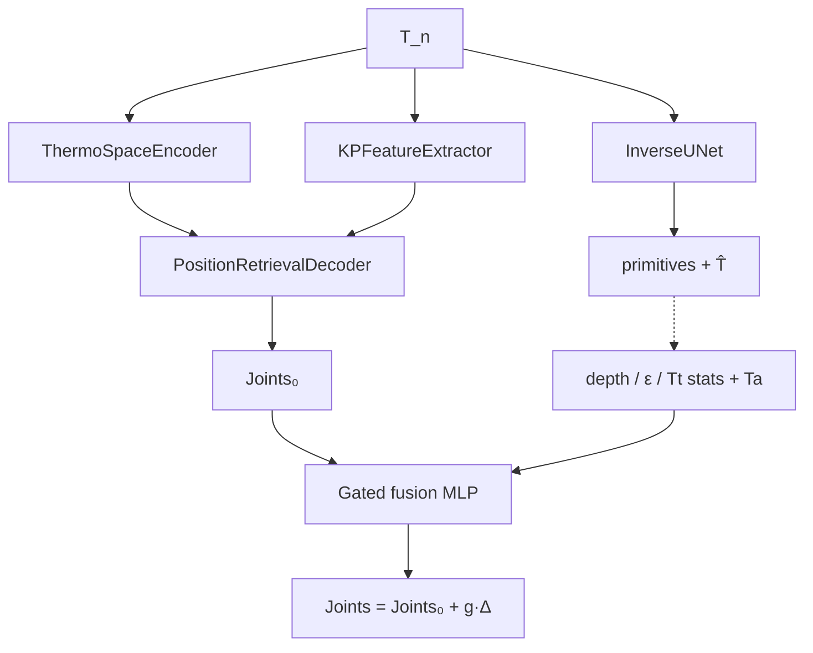
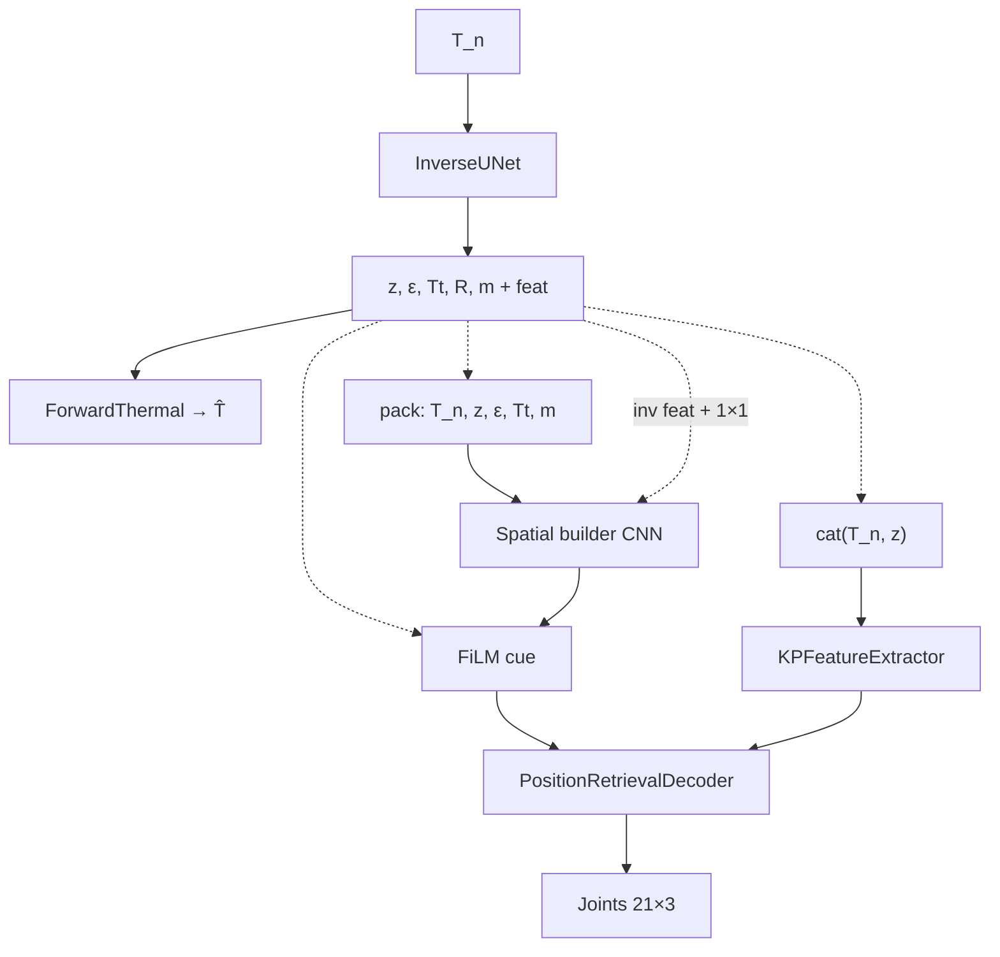
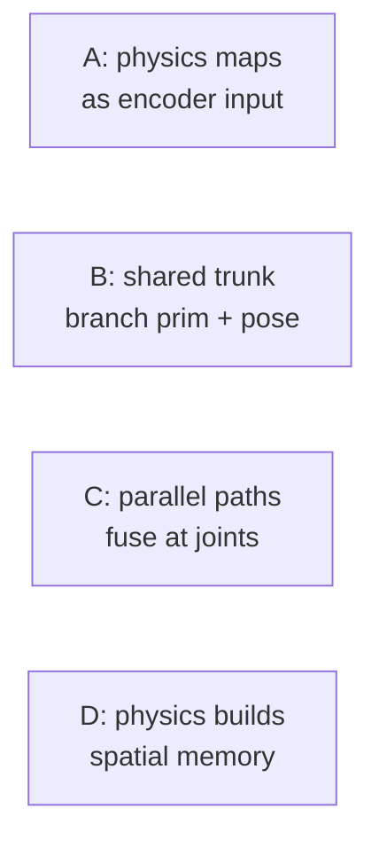

# Hybrid structures A–D

Pose path always ends in **KPFeatureExtractor → PositionRetrievalDecoder → joints**.  
Dashed edges = optional **stop-grad** from physics → pose (phase-2 training).

## A — Inverse → pack maps → TAPOR-style retrieval

## B — Shared ThermoSpace trunk → prim heads + pose

## C — Parallel physics + TAPOR, gated late fusion on joints

## D — Physics maps build spatial space; KP queries it

## Comparison (coupling style)

