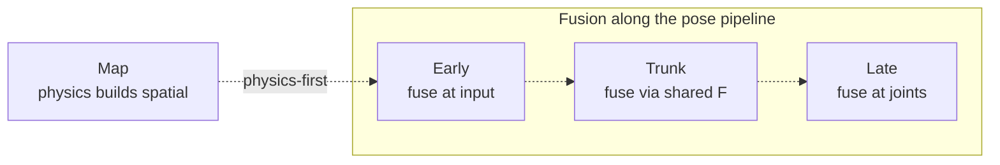
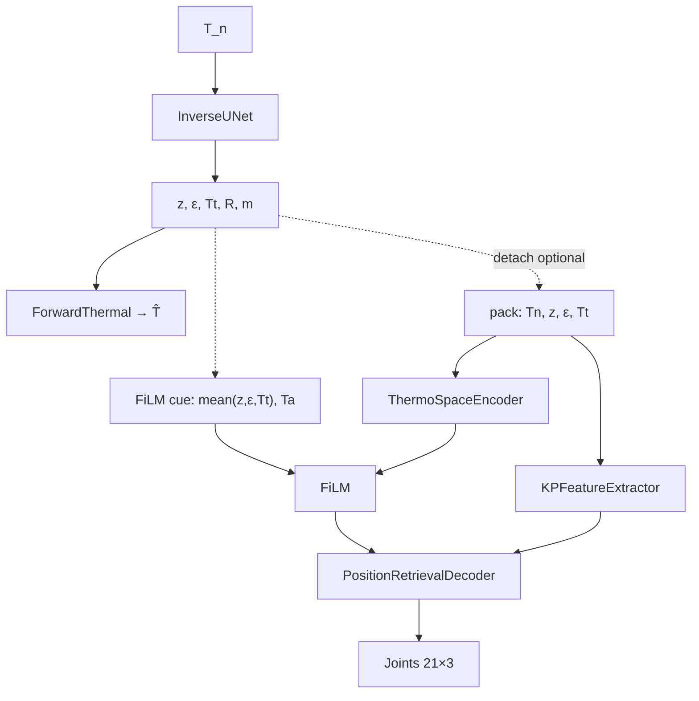
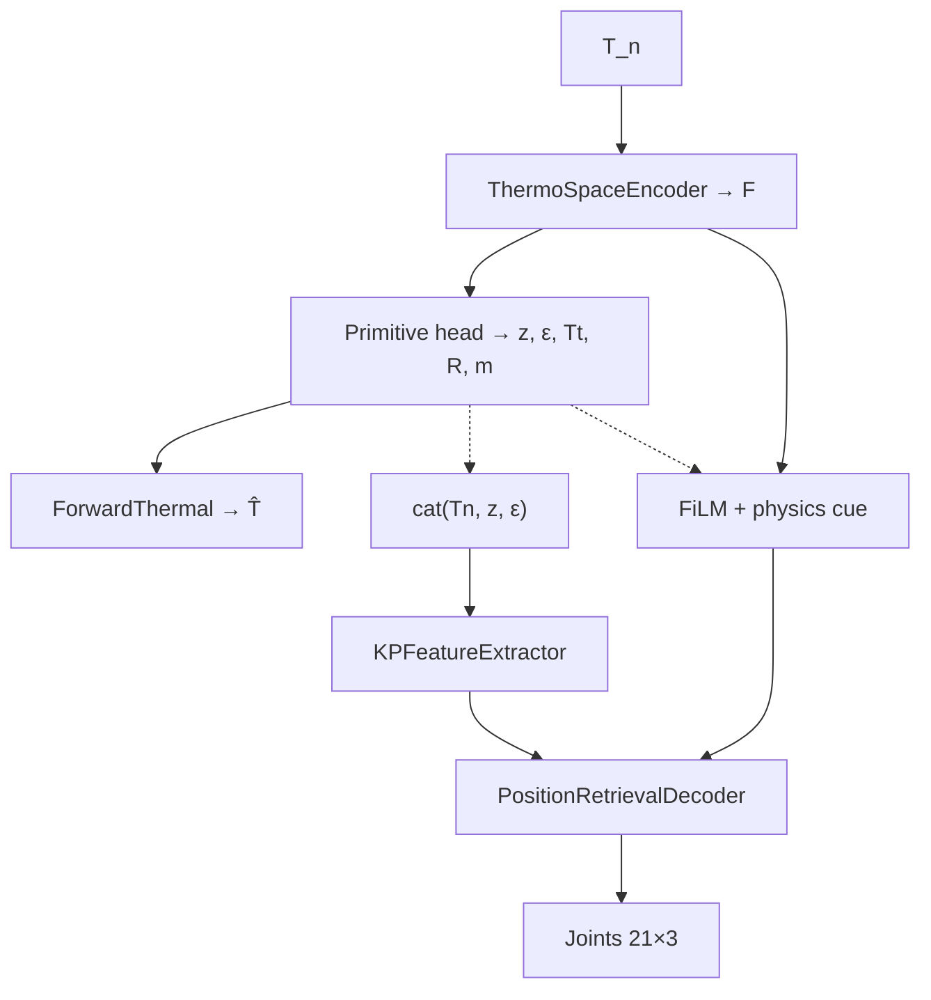
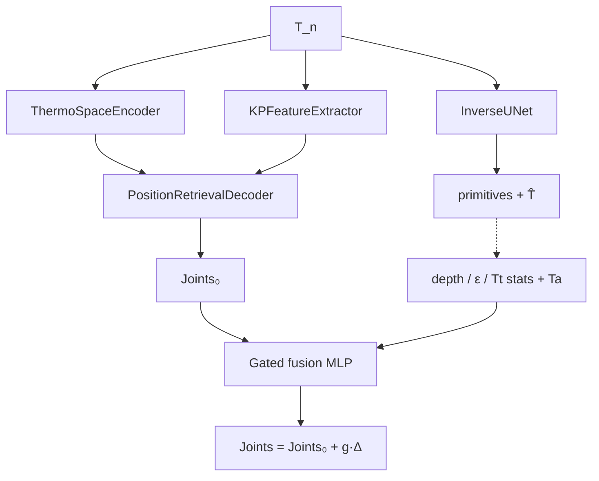
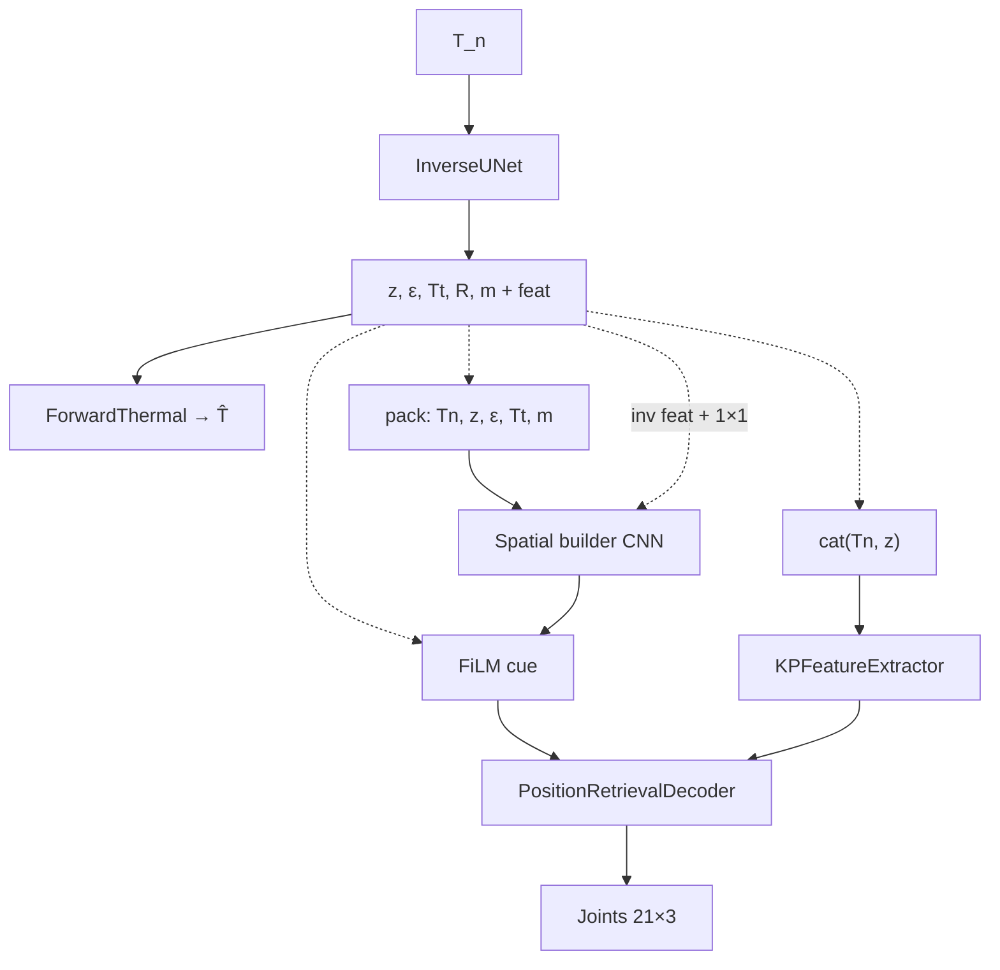
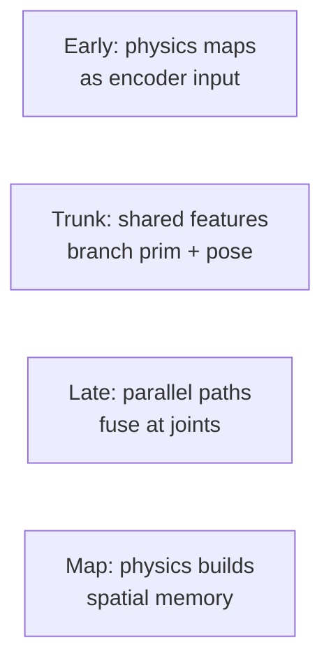

# PhyPose family — four coupling variants

**PhyPose** = physics primitives (inverse ↔ forward) + TAPOR-style pose retrieval  
(keypoints query a spatial map → 21×3 joints).

The four models share the same two ingredients; they differ only in **where physics is fused into the pose pipeline**—at the input (**Early**), in shared mid-level features (**Trunk**), or at the final joints (**Late**). **Map** is physics-first spatial construction (joints query a map built from physics), not on the early–late axis.

| Name | Code (legacy) | Fusion point | One-liner |
|------|---------------|--------------|-----------|
| **PhyPose-Early** | Hybrid A / `hybrid_a.py` | Input | Physics maps stacked as multi-channel input to pose encoding & retrieval |
| **PhyPose-Trunk** | Hybrid B / `hybrid_b.py` | Shared trunk | Shared trunk features branch into physics and pose heads |
| **PhyPose-Late** | Hybrid C / `hybrid_c.py` | Joints | Parallel physics & pose; gated residual fusion on joints |
| **PhyPose-Map** | Hybrid D / `hybrid_d.py` | Spatial map | Spatial feature map built from physics maps; joints query that map |

Dashed edges in diagrams = optional **stop-grad** from physics → pose (phase-2 training).

---

## Shared pieces

1. **Ambient normalize:** \(T_n = T - T_a\)
2. **Inverse:** thermal → primitives \(z\) (depth), \(\varepsilon\) (emissivity), \(T_t\) (surface temp), \(R\) (reflection), \(m\) (mask)
3. **Forward:** primitives → reconstructed thermal \(\hat{T}\) (reconstruction loss under hand mask)
4. **Pose path:** spatial features + 21 joint queries → `PositionRetrievalDecoder` → joints  
   (Early / Trunk / Late use `ThermoSpaceEncoder` + `KPFeatureExtractor`; Map uses a physics-driven spatial builder)

---

## PhyPose-Early — fuse at input

Physics attribute maps stacked with \(T_n\) as multi-channel input to pose encoding & retrieval.

**Coupling:** physics enters pose as **extra input channels** (+ FiLM).

---

## PhyPose-Trunk — fuse via shared features

One ThermoSpace trunk; physics head and pose head branch from the same features.

**Coupling:** physics and pose **share mid-level features**; primitives also cue FiLM / KP inputs.

---

## PhyPose-Late — fuse at joints

Parallel physics and pose paths; gated residual fusion on joints  
\(J = J_0 + g\cdot\Delta\).

**Coupling:** pose runs on \(T_n\) alone until the end; physics only **corrects joints** via a learned gate.

---

## PhyPose-Map — physics builds the spatial map

Spatial feature map constructed from physics maps (+ inverse feature residual); joints query that map.

**Coupling:** physics **constructs** the spatial memory that pose retrieves from (not standard ThermoSpace on \(T_n\) alone).

---

## Comparison (coupling style)

