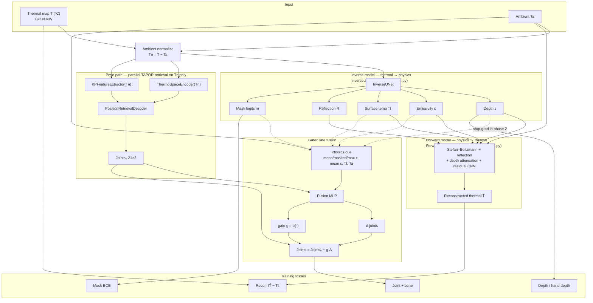
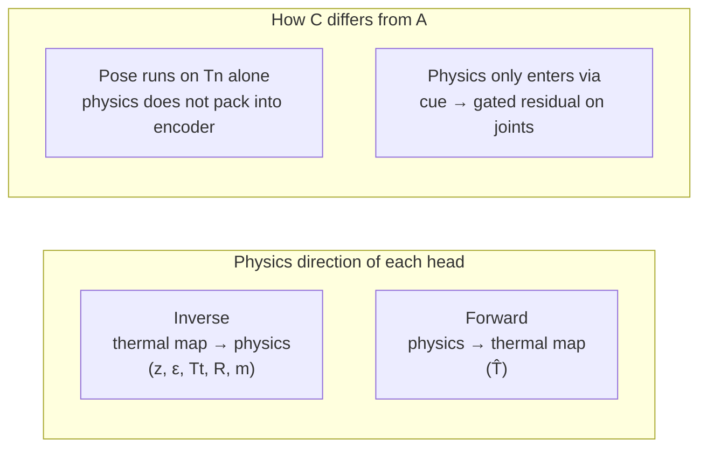

# Hybrid C — system diagram

**Inverse** = thermal map → physics primitives  
**Forward** = physics primitives → reconstructed thermal map  

Parallel paths: physics branch and TAPOR pose branch, then **gated late fusion** on joints.

